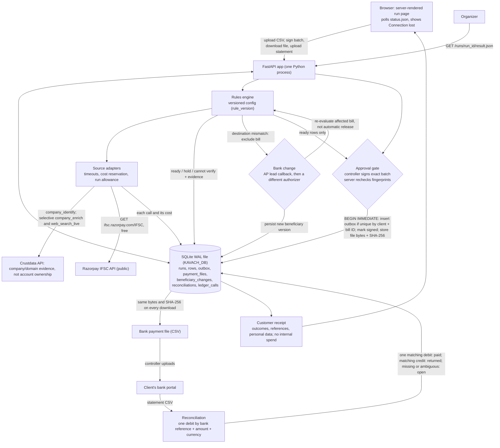

# Kavach architecture

**Invariant: at most one committed payment instruction per `(client_id, bill_id)`, not exactly one execution at the bank.** This diagram describes the implemented supplier-payment path. ERP sync is a prototype, not an input on `main`.

## Decisions and trade-offs

| Decision | Compared with | Benefit and boundary |
| --- | --- | --- |
| One FastAPI process, Jinja, SQLite WAL | Separate SPA, API and worker | HTML and JSON reopen the same stored run. Fewer moving parts to deploy and recover; SQLite still serializes writers. [ADR 0002](adr/0002-one-process-server-rendered-page.md) |
| Versioned rules, with directory evidence separate from beneficiary authorization | A match-only dashboard or an LLM payment verdict | A real company can request an unapproved destination. Hold that bill with a reason; independent clean bills can proceed. An IFSC check confirms a branch, not account ownership. |
| Server-side row fingerprint at sign-off | Treat checked bill IDs as blanket approval | The comparison binds bill ID, amount, currency, account hash, IFSC and beneficiary version. Changed values do not match the old selection. The fingerprint is not a digital signature; the two-person demo checks distinct typed names, not authenticated identities. |
| Commit the outbox and frozen CSV in one transaction | Regenerate the file on download, retry a provider call, or simulate money movement | A crash leaves both the instruction and its bytes or neither. Downloads return the same bytes without sending money. The trade-off is a generic CSV, manual upload and no bank acknowledgement. [ADR 0004](adr/0004-bank-payment-file.md) |
| Match a statement debit by reference, amount and currency | Mark paid when the file is signed or downloaded | Distinguishes instructions from observed debits and returns. Requires statement evidence; the bank can still execute a file uploaded twice. |

**Reference constraint:** `payfile.bank_ref` uppercases and strips non-alphanumerics from the bill ID, prefixes `KV`, and truncates to 18 characters. The database enforces uniqueness, but different bill IDs can normalize to the same reference; this is not a collision-proof ID scheme.

## Components

| Component | Job |
| --- | --- |
| Run page | One workflow: upload approved bills, review, sign, download the payment file, reconcile, inspect receipt. |
| FastAPI app | Parses the CSV, saves the run, serves the page, `result.json`, `receipt.json` and `status.json`. |
| SQLite (WAL) | The only state. Path from `KAVACH_DB`. |
| Rules engine | Decides ready, hold or cannot verify from client records, bills already signed and source evidence. Each run saves its `rule_version`. |
| Source adapters | One adapter per source. Each sets a timeout, reserves cost first and logs the actual cost. |
| Approval gate | Accepts a sign-off only for the exact bills, amounts, currencies, destinations and beneficiary versions shown. |
| Payment file | `kavach/payfile.py`. One CSV per sign-off, written in the sign-off transaction and never changed. Downloads are counted. |
| Bank change screen | `/runs/{run_id}/rows/{n}/change`. The AP lead records the callback through the trusted contact. A different person authorizes the new beneficiary version. The bill is then checked again. |
| Reconciliation | `kavach/reconcile.py`. Matches each signed bill to exactly one statement debit by bank reference, amount and currency. A credit with the reference is a returned payment. |
| Receipt | What finished, what waits, references and personal-data disclosures. Internal metering is separate. |

## Data flow: Pay approved bills

1. The controller uploads bills. Kavach saves every row, masked for display.
2. Rules compare each bill with the approved beneficiary version, payment history and bills Kavach has already signed. A changed account or possible duplicate becomes a hold.
3. Adapters check the IFSC code (Razorpay IFSC API) and corroborate the carrier domain (Crustdata `company_identify`, exact domain equality). A sender-domain mismatch means review, not an accusation.
4. The page shows **Needs attention** first, then the clean batch and its total.
5. The controller signs. The server rechecks and, in one transaction, saves the signed bills and the payment file.
6. The controller downloads the file and uploads it to the bank.
7. The controller uploads the bank statement. Each bill becomes paid, returned or stays open with the reason.

## Historical workflow: Post bank lines (not available for new runs)

1. The controller uploads statement lines.
2. Kavach finds the legal payee from client records, a registry record (planned) or the vendor legal page (AWS contracting-party page, fetched live).
3. A client ledger rule picks the account. Possible duplicates are held. Unknown descriptors are **cannot verify**, with the missing fact named.
4. This job makes no payments.

## Where approvals sit

- Controller sign-off at the approval gate, before any payment file exists.
- AP lead callback through the trusted contact, and a separate authorizer, before a changed beneficiary can enter a batch.
- A beneficiary change after sign-off never changes the frozen file. The page warns "Do not upload this file as it is" and names the bill.

## Where retries sit

- Source adapters: timeouts. A failed source marks only the affected fact **cannot verify**.
- There are no payment retries. A download returns the same file; a second statement upload changes nothing that is already recorded.

## Where the cost ledger sits

External calls are recorded in `ledger_calls`: source, time, credits and status. The adapters enforce the run allowance from `kavach/config.toml`. Internal spend is not customer pricing and does not appear on the customer receipt.

## At-most-once instruction creation

1. The controller signs an exact batch.
2. The server rechecks each item: same amount, currency, destination and beneficiary version.
3. In one SQLite transaction, Kavach saves each bill under a unique `(client ID, bill ID)` with its bank reference (`KV` + bill ID), and writes the payment file bytes and SHA-256.
4. A second upload of the same bill finds the saved record and shows **Already signed earlier**. It never enters a second file.
5. The bank statement proves payment: exactly one debit with the reference, amount and currency. Two debits are reported as a possible double payment by the bank.

## Kill and restart behaviour

- A kill before step 3 commits leaves no signed bill and no file. A kill after it leaves both. There is no state in between.
- After a restart, the same run URL shows the same rows, the same file and the same SHA-256. The page shows "Connection lost" with the last update time while the server is down, then reconnects without resubmitting.
