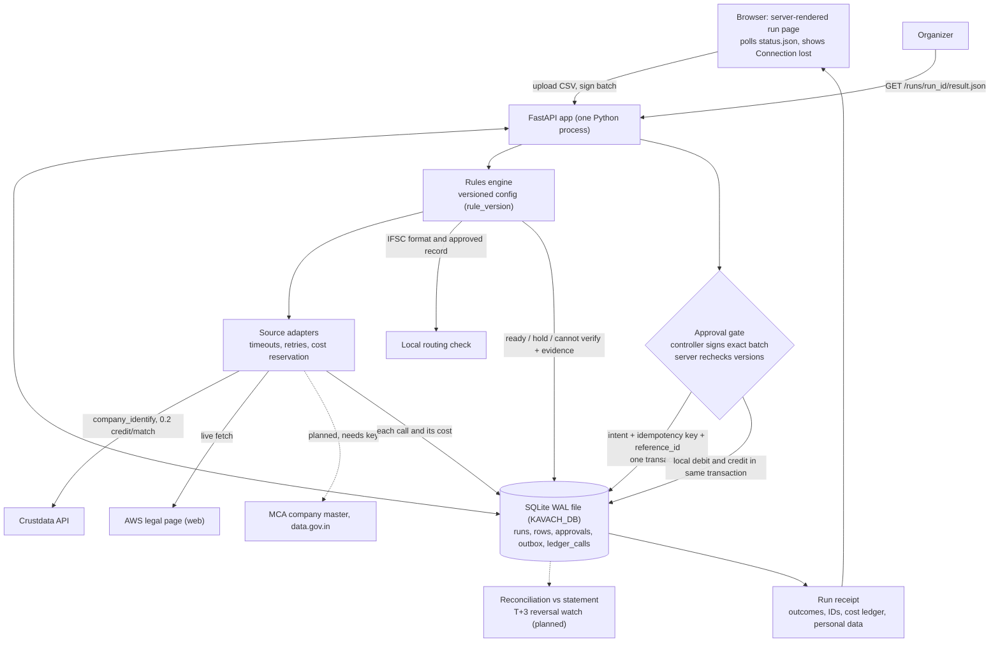

# Kavach architecture

Words follow [`GLOSSARY.md`](../GLOSSARY.md). The current payout path is the [local simulator](adr/0004-local-payout-simulation.md). Dashed boxes are planned.

## Components

| Component | Job |
| --- | --- |
| Run page | Server-rendered HTML with a little JavaScript. Two jobs, upload, review, sign-off, receipt download. Shows only masked fields. |
| FastAPI app | Parses the CSV, saves the run, serves the page, `result.json` and `status.json`. |
| SQLite (WAL) | The page and downloads read the same ledger. Path from `KAVACH_DB`. |
| Rules engine | Decides ready, hold or cannot verify from client records and source evidence. Each run saves its `rule_version`. |
| Source adapters | One adapter per source. Each sets a timeout, retries a limited number of times, reserves cost first and logs the actual cost. |
| Approval gate | Accepts a sign-off only for the exact bills, amounts, currencies, destinations and beneficiary versions shown. |
| Simulator | Records local transfers and balances with sign-off. |
| Receipt | What finished, what waits, IDs, cost ledger, personal-data block. |

## Data flow: Pay approved bills

1. The controller uploads bills. Kavach saves every row, masked for display.
2. Rules compare each bill with the approved beneficiary version and payment history. A changed account or possible duplicate becomes a hold.
3. Rules check IFSC format and the approved record locally. Crustdata can corroborate the carrier domain. A sender-domain mismatch means review, not an accusation.
4. The page shows **Needs attention** first, then the clean batch and its total.
5. The controller signs. The server rechecks and settles eligible demo transfers.

## Data flow: Post bank lines

1. The controller uploads statement lines.
2. Kavach finds the legal payee from client records, a registry record (planned) or the vendor legal page (AWS contracting-party page, fetched live).
3. A client ledger rule picks the account. Possible duplicates are held. Unknown descriptors are **cannot verify**, with the missing fact named.
4. This job has no payout path. It makes zero payout calls.

## Where approvals sit

- Controller sign-off at the approval gate, before any outbox row exists.
- AP lead callback through the trusted contact, and a separate authorizer, before a changed beneficiary can enter a batch.
- An edit after sign-off voids the approval for that item only.

## Where retries sit

- Source adapters: limited retries with timeouts. A failed source marks only the affected fact **cannot verify**.
- A repeated sign-off cannot claim the same client/bill twice.

## Where the cost ledger sits

The adapters write each external call to `ledger_calls`: source, time, credits reserved, actual cost, retries. The rules stop calls at the run allowance in `kavach/config.toml` (600 s, 150 credits). The receipt sums the ledger. Crustdata: 1 credit = $0.30.

## Exactly-once payout procedure

1. The controller signs an exact batch.
2. The server rechecks each item: same amount, currency, destination and beneficiary version.
3. Claim the unique client/bill ID and check available demo funds. Insufficient funds leaves both wallets unchanged.
4. Record the debit, credit, resulting balances and `sim_` ID in the same transaction. Each beneficiary version has its own wallet.
5. The receipt uses the recorded balances. A replay does not transfer money again.

## Kill and restart behaviour

- Working today: after a restart, the same run URL shows the same saved rows. The page shows "Connection lost" with the last update time while the server is down, then reconnects without resubmitting.
- A crash before commit rolls back the transfer. After commit, reopening the saved run returns the same IDs and balances. Old provider runs stay read-only.
