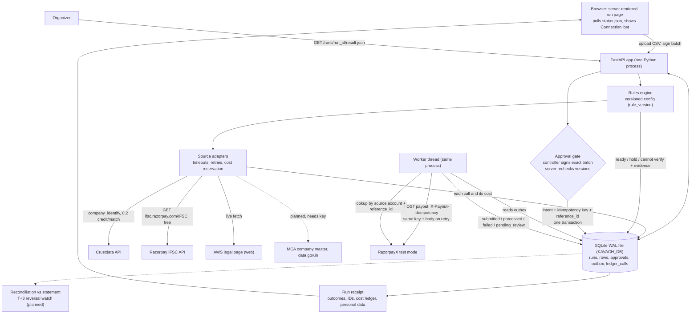

# Kavach architecture

Words follow [`GLOSSARY.md`](../GLOSSARY.md). Status: the page, upload, saved runs, masking, `result.json` and `status.json` work today. The checks, sign-off, outbox, worker, cost ledger and receipt are the design and are **in progress at freeze**. Dashed boxes are planned.

## Components

| Component | Job |
| --- | --- |
| Run page | Server-rendered HTML with a little JavaScript. Two jobs, upload, review, sign-off, receipt download. Shows only masked fields. |
| FastAPI app | Parses the CSV, saves the run, serves the page, `result.json` and `status.json`. |
| SQLite (WAL) | The only state. The page, `result.json` and the worker all read it. Path from `KAVACH_DB`. |
| Rules engine | Decides ready, hold or cannot verify from client records and source evidence. Each run saves its `rule_version`. |
| Source adapters | One adapter per source. Each sets a timeout, retries a limited number of times, reserves cost first and logs the actual cost. |
| Approval gate | Accepts a sign-off only for the exact bills, amounts, currencies, destinations and beneficiary versions shown. |
| Worker thread | Sends payouts from the outbox and recovers after a restart. |
| Receipt | What finished, what waits, IDs, cost ledger, personal-data block. |

## Data flow: Pay approved bills

1. The controller uploads bills. Kavach saves every row, masked for display.
2. Rules compare each bill with the approved beneficiary version and payment history. A changed account or possible duplicate becomes a hold.
3. Adapters check the IFSC code (Razorpay IFSC API) and corroborate the carrier domain (Crustdata `company_identify`, exact domain equality). A sender-domain mismatch means review, not an accusation.
4. The page shows **Needs attention** first, then the clean batch and its total.
5. The controller signs. The server rechecks and writes the outbox. The worker sends the payouts.

## Data flow: Post bank lines

1. The controller uploads statement lines.
2. Kavach finds the legal payee from client records, a registry record (planned) or the vendor legal page (AWS contracting-party page, fetched live).
3. A client ledger rule picks the account. Possible duplicates are held. Unknown descriptors are **cannot verify**, with the missing fact named.
4. This job has no payout path. It makes zero payout calls.

## Where approvals sit

- Controller sign-off at the approval gate, before any outbox row exists.
- AP lead callback through the trusted contact, and a separate authorizer, before a changed beneficiary can enter a batch.
- An edit after sign-off voids the approval for that item only.

## Where retries sit

- Source adapters: limited retries with timeouts. A failed source marks only the affected fact **cannot verify**.
- Worker: retries a payout only with the same idempotency key and the same body. Never a fresh key.

## Where the cost ledger sits

The adapters write each external call to `ledger_calls`: source, time, credits reserved, actual cost, retries. The rules stop calls at the run allowance in `kavach/config.toml` (600 s, 150 credits). The receipt sums the ledger. Crustdata: 1 credit = $0.30.

## Exactly-once payout procedure

1. The controller signs an exact batch.
2. The server rechecks each item: same amount, currency, destination and beneficiary version.
3. In one SQLite transaction, Kavach saves the approved intent under a unique `(client ID, bill ID)`, the source account, destination, amount, currency, idempotency key, exact request body and a unique `reference_id` (max 40 characters).
4. The worker sends the payout with header `X-Payout-Idempotency` set to the saved key.
5. On a response, it saves the provider payout ID and status (submitted, then processed).
6. On a timeout or crash, it retries with the same key and the same body.
7. If still uncertain, it looks up payouts by source account number and `reference_id`.
8. Exactly one match with the approved destination, amount and currency: save it. A confirmed `failed`: show failed and return it to the controller.
9. No match, more than one match, a mismatch or an unavailable provider: `pending_review`. The intent stays locked. No fresh key, no automatic replacement ([ADR 0001](adr/0001-payout-recovery-never-replaces.md)).
10. A second upload of the same bill finds the saved intent and creates no new payout.

## Kill and restart behaviour

- Working today: after a restart, the same run URL shows the same saved rows. The page shows "Connection lost" with the last update time while the server is down, then reconnects without resubmitting.
- Design (in progress at freeze): on start, the worker reads every outbox row that is not final and applies steps 6 to 9. A kill before step 3 leaves no outbox row, so nothing is sent. A kill after the provider accepts is resolved by the same key or the `reference_id` lookup. The rehearsal pass mark is the same three provider payout IDs before and after the restart.
